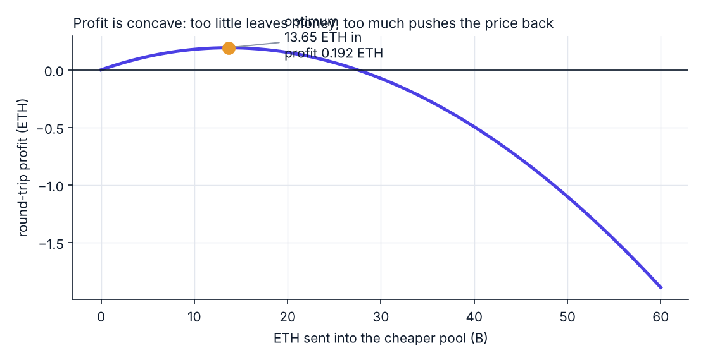
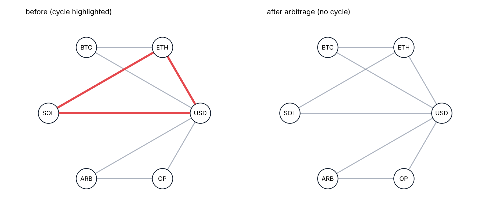
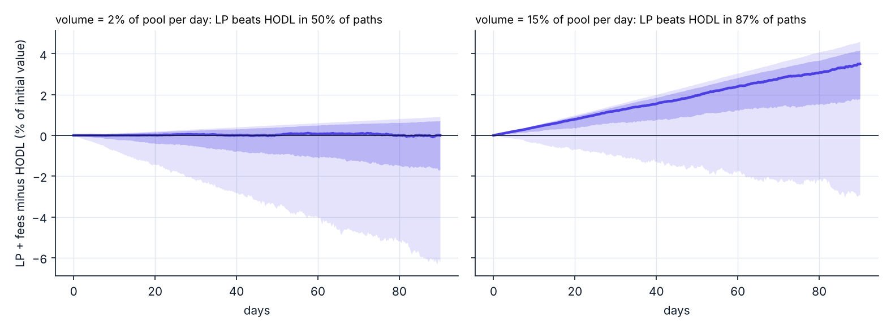
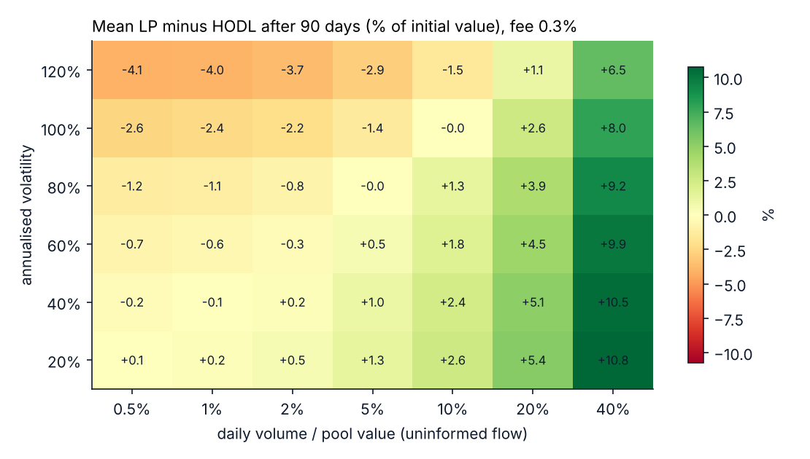
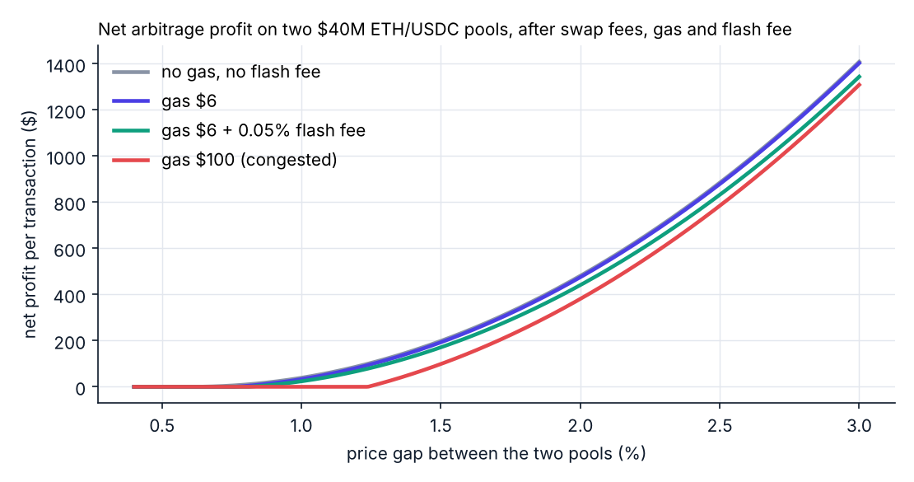

# AMM Arbitrage and Liquidity-Provider Analytics

A small, tested toolkit for constant-product automated market makers (Uniswap v2 math): how big an arbitrage trade should be, where profitable loops hide across many pools, and whether providing liquidity actually pays.

**[Live demo](https://jolikewe.github.io/uniswap-exchange/)**: four interactive tools (curve explorer, optimal-arbitrage calculator, cycle finder, LP lab) running the same maths in the browser.

  

## What and why

1. Between two pools there is a trade size that maximises arbitrage profit; it has a closed form, and the profit is reported net of swap fees on both pools, gas (an explicit parameter) and an optional flash-loan fee, together with the break-even price gap.
2. Across N pools and tokens, profitable loops are negative cycles in a graph of `-log(rate)`; Bellman-Ford finds them and the same closed form sizes them.
3. Liquidity providers sell volatility: a Monte Carlo with arbitrageurs keeping the pool on the external price shows when fee income compensates impermanent loss and loss-versus-rebalancing (LVR), and who is paid what: the arbitrageur, the LP (fees) and the validator (gas).

The original assignment notebook (`uniswap_arbitrage.ipynb`, two pools and a fixed 10 DAI trade) is kept unchanged and its stored numbers are reproduced by the tests.

## Questions answered

| Question | Where |
| --- | --- |
| What input size maximises two-pool arbitrage profit, and when is there no trade? | `notebooks/01_optimal_arbitrage.ipynb` |
| Which loop through many pools is profitable, and how much should be sent through it? | `notebooks/02_cycle_arbitrage.ipynb` |
| How large is impermanent loss, and how does v3 concentration change it? | `notebooks/03_lp_economics.ipynb` |
| For a given volatility, fee and volume, does an LP beat holding? | `notebooks/03_lp_economics.ipynb` |

## Key results

All numbers are from the executed notebooks and tests in this repo.

**Arbitrage sizing** (the original notebook's pools: A = 400 DAI / 1200 ETH, B = 2000 DAI / 5800 ETH, 0.3% fee each):

| Quantity | Value |
| --- | --- |
| Original notebook, fixed 10 DAI (its own fee convention) | 29.233166 ETH in, profit 0.035127 ETH |
| Uniswap v2 math, closed-form optimum | 13.650814 ETH in, buy 4.682069 DAI in pool B, profit 0.191712 ETH |
| Same notebook trade size under v2 math | profit -0.050798 ETH |
| Closed form vs brute force, 297 random pool pairs | max relative error 1.5e-13 in profit, 2.4e-07 in size |



**Cycle arbitrage:** on a six-token, eight-pool example Bellman-Ford finds `SOL -> USD -> ETH -> SOL` (marginal multiplier 1.03067); the optimal input is 34.0220 SOL for a 0.5178 SOL profit, and the market is flat after two trades (the second is worth less than 5e-5 SOL). On 1000 random markets (6 tokens, 9 pools) Bellman-Ford agreed with exhaustive cycle enumeration 1000 times, with an arbitrage present in 735.



**Liquidity provision** (full-range v2 position, 0.3% fee, 90 days, GBM external price, zero drift):

| Check | Result |
| --- | --- |
| Impermanent loss at a 2x / 4x price move | -5.7191% / -20.0000% |
| E[LVR] over one year at 80% vol, fee 0: simulated vs closed form | 0.07719 +/- 0.00021 vs 0.07688 |
| 80% vol, 2% of the pool traded per day | mean LP minus HODL -1.009% +/- 0.070, LP wins in 50% of paths |
| 80% vol, 15% of the pool traded per day | mean +2.470% +/- 0.070, LP wins in 87% of paths |
| Break-even daily volume at 80% vol, 0.3% fee: rule of thumb vs simulation | 7.31% vs 6.41% of the pool per day |
| Concentrated range +/-10% (v3) capital efficiency | 21.49x versus full range, with a steeper IL curve |




## Profit, net of costs: a mainnet-sized example

**Assumptions (illustrative, no live data).** Two v2-style ETH/USDC pools, each 10,000 ETH and 20,000,000 USDC (about $40M, $2,000 per ETH), 0.3% fee each. Gas 150,000 units x 20 gwei x $2,000 = $6 per transaction. Flash-loan fee 0.05% in the table below (a parameter; real values depend on the lender). USDC is $1.

| Price gap between the pools | Trade size | Gross (after swap fees) | Gas | Flash fee | Net profit |
| --- | --- | --- | --- | --- | --- |
| 0.4% to 0.8% | not worth sending | | | | |
| 1.0% | $17,300 | $38.46 | $6.00 | $8.65 | $23.81 |
| 2.0% | $66,991 | $480.48 | $6.00 | $33.50 | $440.99 |
| 5.0% | $214,622 | $4,695.14 | $6.00 | $107.31 | $4,581.83 |

Break-even price gap (smallest gap with positive net profit): 0.603% with no gas, 0.758% with $6 gas, 0.951% with $30, 1.239% with $100; a 0.05% flash fee adds 0.05 percentage points.



**Who earns what** (same $40M pool, 80% volatility, 0.3% fee, 5% of the pool traded per day by uninformed flow, 90 days, hourly steps, $6 arbitrage gas, 400 paths; dollars for the whole pool):

| | Mean |
| --- | --- |
| LP fee income from uninformed volume | $533,469 |
| LP loss versus rebalancing (LVR) | $488,779 |
| Arbitrageurs' net profit | $480,380 |
| Validators (gas): LVR minus arbitrageur profit | $8,399 |
| LP minus HODL | +$13,415 (LP beats HODL in 67% of paths) |

Without gas the arbitrageur's profit equals the LP's LVR exactly; gas paid by arbitrageurs is part of the LP's loss but goes to validators.

**What this model ignores.** Competition between searchers (priority fees and MEV auctions usually take much of the profit), other trades in the same block, price movement before inclusion, real-time gas variation, and Uniswap v3 liquidity ticks when sizing arbitrage (v3 appears only in the impermanent-loss range maths). Pool sizes, gas and ETH price are inputs, not market data.

## Mathematics

**Swap.** With `g = 1 - fee`, `amount_out = x_in * g * R_out / (R_in + x_in * g)`. The whole `x_in` joins the reserve, so `k = R_in * R_out` never decreases.

**Optimal arbitrage.** A hop is the map `a -> alpha*a / (beta + delta*a)` with `alpha = g*R_out`, `beta = R_in`, `delta = g`. Composing hops keeps the form `a -> A*a / (B + C*a)` with `A' = alpha*A`, `B' = beta*B`, `C' = beta*C + delta*A`. Profit `A*a/(B + C*a) - a` is concave, so setting its derivative `A*B/(B + C*a)^2 = 1` gives

```
a* = (sqrt(A*B) - B) / C          profit* = (sqrt(A) - sqrt(B))^2 / C          profitable iff A > B
```

With a proportional flash-loan fee `phi` (`lambda = 1 + phi`) the objective is `A*a/(B + C*a) - lambda*a`, giving `a* = (sqrt(A*B/lambda) - B)/C` and `profit* = (sqrt(A) - sqrt(lambda*B))^2 / C`. Gas is a fixed cost, so it does not move `a*` and is subtracted from `profit*`; the break-even gap is where the net profit reaches zero (bisection in `breakeven_mispricing`).

For two pools the condition `A > B` is the price gap exceeding the combined fees; the same formula sizes a cycle of any length.

**Cycle detection.** Edge weight `-log(g * R_out / R_in)`; a negative cycle has product of marginal rates above 1. Bellman-Ford from a virtual source finds one.

**Impermanent loss.** For `r = S_T / S_0`, pool value `V0*sqrt(r)`, HODL value `V0*(1 + r)/2`, `IL(r) = 2*sqrt(r)/(1 + r) - 1`.

**LVR and the simulation.** An arbitrageur moves the pool to the edge of the fee band after every step. Buying until the marginal price `u^2/(g*k) = S` with `u = y + g*dy` gives `dy = (sqrt(g*k*S) - y)/g` (symmetric when selling), in closed form. For zero-drift GBM and no fee, `E[V_T] = V0*exp(-sigma^2*T/8)` and the rebalancing portfolio is a martingale, so `E[LVR] = E[pool - HODL] = -V0*(1 - exp(-sigma^2*T/8))`; the Monte Carlo is tested against this. Uninformed volume is modelled as price-neutral flow that only pays fees (a fixed fraction of pool value per day); arbitrage fees stay in the reserves.

**Break-even rule of thumb.** Fee income rate `fee * turnover` versus LVR rate `sigma^2/8` gives `turnover = sigma^2 / (8 * 365 * fee)` per day. It ignores that fees shrink arbitrage flow, so it is conservative: the simulated break-even was lower at 40% and 80% volatility (1.35% vs 1.83% and 6.41% vs 7.31%) and close at 120% (16.01% vs 16.44%).

**Uniswap v3.** For liquidity `L` in range `[pa, pb]`: `x = L*(1/sqrt(p) - 1/sqrt(pb))`, `y = L*(sqrt(p) - sqrt(pa))`, with the price clamped to the range.

## Repository structure

```
.
├── amm/                          # pure Python + NumPy package
│   ├── pool.py                   # constant-product pool, v2 swap maths
│   ├── arbitrage.py              # closed-form optimum, profit curve, brute-force check
│   ├── cycles.py                 # Bellman-Ford detection, cycle sizing, run-until-flat
│   ├── lp.py                     # IL, LVR, arbitrageur step, GBM Monte Carlo
│   ├── v3.py                     # concentrated-liquidity position maths
│   └── legacy.py                 # the original notebook's pool model (for reproduction)
├── tests/                        # pytest suite
├── notebooks/                    # executed analyses (outputs stored)
├── assets/                       # figures saved by the notebooks
├── uniswap_arbitrage.ipynb       # original notebook, unchanged
├── pyproject.toml
└── requirements.txt
```

## Getting started

```bash
pip install -r requirements.txt
jupyter notebook notebooks/        # run top to bottom; figures are written to assets/
```

```python
from amm import Pool, two_pool_arbitrage, simulate_lp, summarise

a, b = Pool("DAI", "ETH", 400, 1200), Pool("DAI", "ETH", 2000, 5800)
print(two_pool_arbitrage(a, b))                                   # optimal size and profit
print(summarise(simulate_lp(0.8, 0.003, turnover=0.05, days=90))) # LP vs HODL statistics
```

## Tests

```bash
python -m pytest
```

38 tests cover: `k` never decreasing with fees; closed-form optimum equal to brute force on random pools; Bellman-Ford agreeing with exhaustive cycle search; IL formula versus pool simulation (agreement to 1e-12 or better); Monte Carlo LVR versus its closed form; v3 edge-continuity; and the original notebook's numbers (ETH required 29.233166, profit 0.035127, `k` values 480288.0, 480536.424828, 12000297.520661), which are also checked against the notebook's stored output.

## Notes and limitations

- The original notebook charges its fee as a surcharge on the input and reads the output from the fee-free curve; `amm.pool.Pool` uses the Uniswap v2 convention. The two differ, which is why the notebook's trade and the v2 optimum are reported separately.
- Cycle sizing assumes each pool appears once in a cycle. Gas, latency and competing searchers are not modelled.
- The LP simulation assumes GBM prices and price-neutral uninformed flow; the volume levels in the heatmap are inputs, not estimates of real markets.
